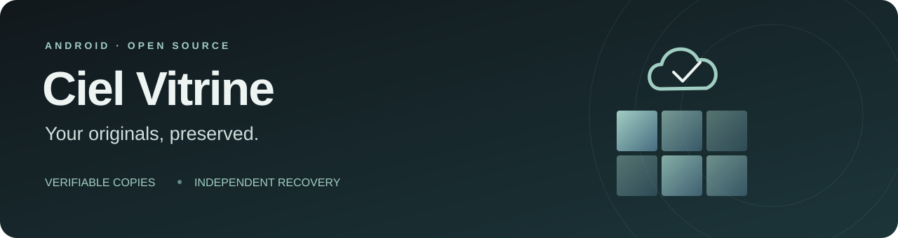
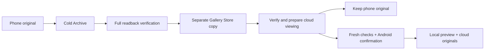

<p align="center"></p>

<p align="center">
  <a href="https://github.com/mvwj/ciel-vitrine/actions/workflows/android.yml"></a>
  <a href="https://github.com/mvwj/ciel-vitrine/actions/workflows/security.yml"></a>
  <a href="LICENSE"></a>
  
  
</p>

<p align="center"><b>Небесная витрина</b> · <a href="README.ru.md">По-русски</a> · <a href="docs/README.md">Documentation</a> · <a href="CONTRIBUTING.md">Contributing</a></p>

Ciel Vitrine is an Android gallery built around verifiable cloud originals.
Browse a dark, day-grouped timeline, keep small local previews and open media
from your own cloud storage. Yandex Disk is the first integration; one provider
is connected at a time. Google Drive is planned.

**Development preview.** Recovery, viewing and removal have different checks.
Keep an independent backup while testing. Current work and limits are recorded
in [the development plan](docs/DEVELOPMENT_PLAN_RU.md) and
[validation reports](docs/README.md#validation).

## What it does

| | Behavior |
|---|---|
| **Gallery** | Day headers, square thumbnails with small gutters, date scrollbar and haptics, folders, favorites and local albums. |
| **Cloud state** | Per-photo badges and queue stages distinguish local files, upload, verification, cold archive, working copy and failures. |
| **Originals** | Exact source bytes, full readback verification, SHA-256 and recorded source dates. Preview generation does not rewrite originals. |
| **Cloud photos** | JPEG/PNG detail is fetched as authenticated, independently encrypted visible tile ranges after preparation. |
| **Video** | Media3 playback, seeking and multipart original reads. Prepared SDR qualities are separate derivatives. HDR depends on native device support. |
| **Recovery** | Self-contained containers and independent Python/JVM decoders, with compatibility for older formats. |

## Archive first



Selected uploads offer **keep on device** and **free device space**. Both keep
the cold archive separate from the working original. A completed upload or a
thumbnail alone never authorizes local removal. Workers cannot delete local
originals; Android requests the user's explicit confirmation after fresh checks.

Local removal currently requires Android 11+, a declared complete resource set,
two verified copies and a supported cloud viewing path. It is permanent local
removal, not a 60-day device trash. Android cannot lock a photo against an
external edit while its confirmation dialog is open. See
[the complete workflow and limits](docs/CLOUD_STATUS_AND_LOCAL_RELEASE_RU.md).

## Privacy model

**The recovery key is included in each original container.** AES-GCM protects
the container structure, but a cloud provider or anyone with that file can
recover its original bytes and EXIF/GPS. This design favors recovery without a
separate key; it does not provide secrecy from the provider. A `.bin` or `.cv2` extension
does not change that property.

OAuth tokens and device catalogs use separate Android Keystore protection.
Your OAuth registration, signing keys, sessions, media and local settings do
not belong in Git. See [security and reporting](SECURITY.md).

## Build

Requires JDK 17+, Android SDK 36, Build Tools 36.0.0, NDK 28.2.13676358 and
CMake 3.22.1. Configure `ANDROID_HOME` or an ignored `local.properties`.

```sh
git clone https://github.com/mvwj/ciel-vitrine.git
cd ciel-vitrine
python -m pip install -r requirements-recovery.txt
./gradlew test :app:assembleDebug :app:lintDebug
python scripts/test_pos_fixtures.py
python scripts/test_pos2_fixtures.py
```

Windows: use `gradlew.bat`, or [the local build helper](scripts/build-local.ps1).
`POS2_PYTHON` can select a Python environment with the recovery requirements.
The APK is generated at `app/build/outputs/apk/debug/app-debug.apk`.

The default public build works as a local gallery. To enable Yandex sign-in,
copy `oauth.properties.example` to ignored `oauth.properties` and configure
your own public Client ID and signing certificate using
[the setup guide](docs/YANDEX_SETUP_RU.md). A client secret is never needed in
the Android app. CI builds use an unregistered placeholder and a separate debug
certificate, so they are not preconfigured for the maintainer's account.

Android instrumentation uses generated media and pinned public samples. Run
the complete suite on an **isolated emulator**, following
[the testing guide](CONTRIBUTING.md). Real-cloud tests require explicit opt-in.

## Recover without the app

```sh
python pos-reference-decoder/python/ciel_pos2_decoder.py original.bin --output recovered.bin
```

This supports CVPOS2/3. A [separate decoder](pos-reference-decoder/python/ciel_pos_decoder.py)
supports legacy POS v1; `:pos-reference-decoder:installDist` builds the JVM tools.
Recovery verifies framing, authentication tags, hashes, the final record and EOF.
An independently stored original hash establishes identity beyond a container's
internal consistency. [Format specification](docs/CVPOS3_SPEC.md).

## Current boundaries

- Automatic Live Photo/sidecar pairing and complete catalog recovery after
  reinstall are unfinished. Unsupported formats retain their local originals.
- Two copies on the same provider do not protect against losing that account.
  Cloud deletion and a 60-day cloud trash are not available in the app.
- Multipart originals have no 128 MiB admission cap. Whole-photo tile
  preparation currently uses a 256 MiB original cache; this is a separate limit.
- Native HDR rendering needs compatible Android hardware. HDR quality
  transcoding is disabled; reduced qualities are prepared SDR derivatives.
- Test results cover their stated fixtures and fault scenarios. They are not a
  guarantee against every possible failure or an independent security audit.

## Explore the project

- [Architecture and module map](docs/ARCHITECTURE.md)
- [Documentation and validation index](docs/README.md)
- [Partial cloud photo protocol](docs/PARTIAL_CLOUD_VIEW_RU.md)
- [Video and large originals](docs/VIDEO_AND_LARGE_ORIGINALS_RU.md)
- [Contributing](CONTRIBUTING.md) · [Security](SECURITY.md) · [Third-party materials](THIRD_PARTY_NOTICES.md)

Licensed under [Apache-2.0](LICENSE). Copyright 2026 Ciel Vitrine contributors.
