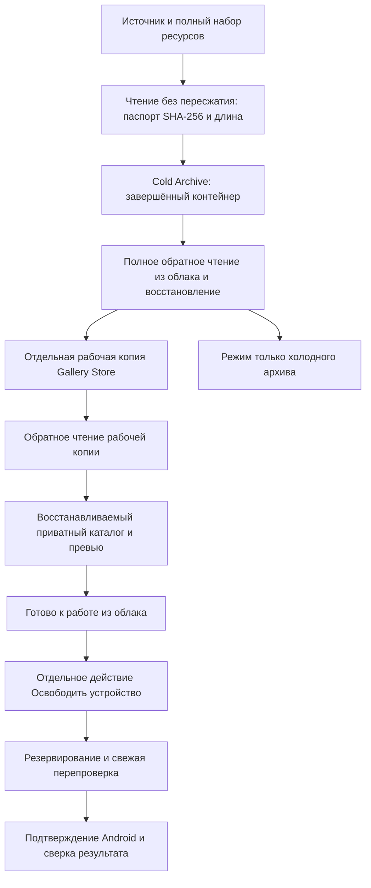

# План разработки и сверка требований — v30

5 октября 2026. Проект «Небесная витрина» / Ciel Vitrine. Этот документ фиксирует требования пользователя и реальное состояние кода. Исторические схемы описывают намерения, а не готовые гарантии.

## 1. Принятые решения

1. Только Android. В одном хранилище один активный провайдер и аккаунт. Первым подключаем Яндекс Диск; затем Google Drive с отдельными проверками возможностей.
2. Оригинал сохраняем как точные байты без декодирования и пересжатия. Это относится к фото, GIF, видео, RAW, Live/Motion Photo и неизвестным форматам. Архивирование любого формата и возможность его просмотра — разные функции.
3. Все долговременные облачные оригиналы, включая рабочие оригиналы галереи, восстанавливаются без личного ключа. Пользователь выбрал «самодостаточный контейнер, облако технически может прочитать оригинал». Поэтому E2E-конфиденциальность этих оригиналов не обещаем. Встроенные EXIF/GPS имеют ту же политику.
4. Каталог, альбомы, избранное, приватные журналы и производные изображения защищаем отдельными секретными ключами. Потеря приватного ключа может лишить организации галереи, но не байтов оригиналов. После освобождения устройства миниатюры принадлежат приложению; поддельные записи MediaStore не создаём.
5. Cold Archive и Gallery Store — физически отдельные объекты и пространства в одном облаке. Две ссылки на один объект не считаются двумя копиями. Обе зоны имеют общий риск отказа аккаунта/провайдера.
6. Сначала полностью записанный и проверенный Cold Archive для **каждого текущего набора ресурсов снимка**, затем Gallery Store и облачные производные. Просмотр местных фото, разрешения, навигация и подготовка каталога доступны сразу.
7. При первом подключении один раз объясняем и сохраняем строгую политику. При каждом действии повторный вопрос об архиве не нужен. Смена хранилища или ослабление защиты — отдельное решение. В первой версии обход строгой политики не включаем.
8. «Архивировать все доступные фото и видео» — отдельная очередь только Cold Archive, без рабочей галереи и удаления с телефона. Ограниченный доступ Android означает «все доступные», а не «всё устройство».
9. Загрузка ничего автоматически не удаляет. «Освободить устройство» — отдельная операция после проверки и подтверждения Android.
10. Корзина галереи — 60 суток. Истечение срока само по себе не разрешает уничтожить последнюю копию.

## 2. Как соединяются архив и галерея

Барьер относится к одному снимку/Live Photo, а не ко всей бесконечно растущей библиотеке. Иначе новое видео или один недоступный файл остановит все уже защищённые снимки. Оба исходных ресурса Live Photo обязательны: сохранённый JPEG не разрешает удалять ещё не сохранённый MOV. Эвристика парности не должна уничтожать файлы.

Нельзя одновременно обещать один проход по источнику, полную проверку архива до начала Gallery и отсутствие временного места. При доказанном server-side copy копируем в отдельный объект и проверяем назначение. Иначе повторно потоково читаем проверенный архив и загружаем Gallery либо используем ограниченный staging. Источник остаётся до завершения защиты. HTTP multipart upload не заменяет собственный независимо восстанавливаемый multipart-формат.

Ремонт симметричен: хорошая рабочая копия может восстановить повреждённый архив, хороший архив — рабочую копию. Создаём новый объект, проверяем его и только затем переключаем ссылку. До ремонта освобождение телефона и опасные операции остановлены. Единственная хорошая копия не перезаписывается.

## 3. Паспорт оригинала

Связи: Asset → Resource → неизменяемая ResourceVersion. Паспорт содержит вид исходного представления, точную длину, SHA-256 прочитанных исходных байтов, URI/эпоху MediaStore/поколение/область доступа до и после чтения. Изменившиеся байты создают новую версию.

Разрешение, кодек/контейнер, глубина цвета, ICC, HDR, ориентация, частота кадров, длительность, EXIF и парность сохраняются как диагностика. Они не доказывают равенство: одинаковые разрешение и вес не исключают подмену. Для удаления нужен хеш и длина точного исходного представления; редактированная/транскодированная/редактированная по GPS версия не называется камерным оригиналом.

Доказательство облачной копии привязывается к версии, аккаунту, корню, физическому набору, порядку/размерам/диапазонам частей, наблюдаемым ревизиям, поколению инвалидирования и моменту проверки. HTTP 201, список файлов, путь или совпавший MD5 не заменяют восстановление точных байтов. Пока destructive preflight допускает только FULL_RECOVERY_READBACK. Более дешёвые доказательства требуют отдельного подтверждения контракта провайдера.

Перед удалением нужны свежие наблюдения облачных объектов и источника, полный текущий набор ресурсов, резервирование, отсутствие конфликта писателя и восстанавливаемый каталог. Возраст доказательства не заменяет проверку ревизии. После Android consent сверяем фактический результат. Потеря доступа означает неизвестность, а не отсутствие.

Паспорт остаётся после освобождения телефона, потому что оригинал ещё есть в облаке. При удалении из галереи активная проекция уходит в корзину; доказательства и намерение сохраняются до результата. После полного согласованного удаления убираем содержательные записи и сохраняем минимальное идемпотентное намерение для повторов/предотвращения автоматического повторного бэкапа. Его очистка отдельно от медиатеки. Новое импортированное фото не удаляем только из-за совпавшего хеша со старым.

## 4. Области удаления

| Действие | Телефон | Gallery Store | Cold Archive | Видимость и повторный бэкап |
|---|---|---|---|---|
| Загрузить / архивировать | Сохраняется | По режиму | Создаётся и проверяется | Без удаления |
| Освободить устройство | Удаляется после проверки | Сохраняется | Сохраняется | Миниатюра в ленте, оригинал подгружается |
| Скрыть из ленты | Без изменения | Без изменения | Без изменения | Доступно в облачном менеджере |
| Удалить рабочую копию в облаке, оставить телефон | Проверенный источник остаётся | Корзина 60 дней | Сохраняется | Явное исключение рабочего бэкапа |
| Удалить из галереи и телефона | Системное действие после проверки | Корзина 60 дней | Сохраняется | Снимок в корзине; можно восстановить и скачать |
| Удалить только холодный архив | Без изменения | Сохраняется, если есть | Отдельное отложенное удаление | Архивное исключение; Free Up запрещён до нового архива |
| Удалить все известные копии | Только явно | Корзина с сохранённой областью | Включается только явно | Подтверждение срока и уничтожения последней копии |

«Только облако» недостаточно точно: там две зоны. Диалог показывает, затрагивается ли холодный архив. Полное уничтожение не выбираем по умолчанию. BackupIntent, Visibility и DeletionIntent независимы: скрытие не становится удалением, исключение не становится отсутствием.

«Удалить только с телефона и не показывать в ленте» — освобождение плюс скрытие. «Оставить на телефоне, удалить в облаке» не освобождает устройство. Облачный менеджер показывает скрытые Gallery-копии, самостоятельный архив, доступность, статус проверки и команды скачать/вернуть в ленту.

60-дневный срок принадлежит корзине приложения. Возможности и сроки MediaStore/системной корзины отличаются; единую гарантию из них не изображаем. Перед удалением устройства должны существовать достаточные облачные копии. Восстановление возвращает галерею и, по выбору пользователя, скачивает файл на телефон.

При восстановлении отменяем будущий purge через поколение операции. Уже отправленное удаление может иметь неизвестный результат: резервирование остаётся до сверки. Purge проверяет каждый ресурс и исключает из числа оставшихся всю свою область; COMMITTED без доказательства не считается хорошей копией. Неясный destructive request нельзя повторять вслепую по одному пути.

## 5. Исправленные ошибки найденного кода

| Ошибка | Изменение этой ветки |
|---|---|
| База возвращала пустые хеш/длину/корень/части доказательства | Полное сохранение; старые неполные строки не разрешают удаление |
| Free Up проверял только VERIFIED/readable | Проверяет паспорт, аккаунт, корень, физический набор, ревизию, поколение, части и свежесть |
| Можно передать только still-ресурс Live Photo | Требуется полный committed ResourceSetRevision и принадлежность Asset |
| Две зоны могли ссылаться на один объект | Строгое освобождение отклоняется |
| Резервирование не запрещало второе удаление | BEGIN IMMEDIATE и проверка пересечения ресурсов/объектов между БД-экземплярами |
| Ошибка после отправки удаления освобождала резервирование | Неясное выполнение остаётся EXECUTING |
| Терминальное состояние и outbox писались отдельно | Транзакционный commit |
| Корзина считала COMMITTED достаточной копией | VERIFIED вне purge-области для каждого ресурса |
| Восстановленная корзина могла опять перейти к purge | Терминальные состояния сохраняются |
| POS не проверял digest контейнера, смещения, общий footer, хвост и границы аллокаций | Проверки добавлены; одиночный writer отказывает в неподдерживаемом multipart |
| SHA префикса выдавался за SHA всего объекта | Writer возвращает SHA полного файла; footer содержит SHA префикса |
| Python footer имел неверный struct, тест ничего не декодировал | Исправлен независимый decoder; тестирует реальные Kotlin-контейнеры |
| Ошибка фонового decoder терялась на pipe EOF; range reader игнорировал CRC | Ошибка передаётся читателю; range проверяет CRC/порядок/границы |
| Был только JVM-проект с описанием «Online art gallery» | Добавлены Android-приложение и точное описание состояния |

JVM-прототип ещё не production-система. Writer-head проверки пока поступают от вызывающего кода; control/catalog storage использует JDBC. Android APK не подключает этот прототип к удалению пользовательских файлов.

## 6. P0 до выпуска облачного формата

POS v1 использует публичный XOR и внешнюю спецификацию. Это точное восстановление без секретов, но не криптографическое шифрование. 32-байтовый идентификатор спецификации не выполняет требование полного описания внутри контейнера.

Следующий формат обязан нести ограниченный неисполняемый bootstrap: порядок байтов, поля/размеры, правила частей, алгоритм восстановления и покрытие хешей. Для именно криптографического преобразования используем стандартный AEAD, например AES-256-GCM, с ключом восстановления внутри публичного контейнера. Это всё равно не конфиденциальность от облака. Приватный слой использует другой секретный ключ вне контейнеров оригиналов. Собственный криптоалгоритм не придумываем.

Формат замораживаем по golden fixtures двух независимых реализаций. Multipart требует whole-file digest/manifest, диагностики отсутствующих/дублированных/смешанных частей и bounded random access. До этого одиночный writer не заявляет поддержку больших наборов. Прототипные exports сохраняются с decoder и спецификацией, как offline recovery package.

## 7. Этапы разработки

| Этап | Результат и критерий готовности |
|---|---|
| 0 — эта ветка | Сверка требований, исправления ядра, Android APK, независимое POS-восстановление, JVM regression tests и lint |
| 1 — формат и Android storage | Самодостаточный format v2, multipart; Android SQLite/Room control с FULL; атомарные паспорт/ресурсная группа/proof/outbox; kill/power-loss recovery; source bindings |
| 2 — Яндекс OAuth и Archive only | LoginSDK, Keystore-токен, аккаунт/корень; durable jobs/resume/reconcile; archive-all; полный readback реальных объектов |
| 3 — Gallery Store и подгрузка | Отдельная рабочая копия; archive gate; секретные миниатюры/каталог; bounded memory/range reads; cloud viewer и скрытые файлы |
| 4 — освобождение и корзина | Android consent и свежее revalidation; журнал/отмена; scoped 60-day Trash; fault-injection и конкуренция до включения кнопок |
| 5 — масштаб, форматы, Google Drive | Каталог с paging по capture date, быстрая шторка/прыжки; Live/Motion Photo; HDR/RAW/codec capabilities; probes Google Drive и смена единственного аккаунта |

В APK уже есть MediaStore-медиатека порциями по 240 записей, месяцы недавних добавлений, папки/избранное/местные альбомы, просмотр фото/GIF/видео и масштабирование, выбор будущего облака и политики, ручной POS-export/import с повторным чтением. Экраны сообщают, что аккаунт ещё не подключён.

Ещё не готовы: OAuth/облачная очередь; cloud thumbnails/viewer; самодостаточный final-format и multipart; Live Photo pairing; гарантированное отображение всех RAW/HDR/кодеков; Android safety DB; actual Free Up/Trash; capture-date fast scrolling; production-scale каталог. Местные альбомы пока используют URI; смена эпохи/переимпорт требует постоянных resource identities. Облачная защита приватной организации ещё не подключена.

## 8. Проверки перед включением удаления

- Коррупция/усечение/footer/смешанные части/подмена публичных хешей при несовпадающем доверенном паспорте; независимое восстановление без приложения и сети.
- Источник изменился до/во время/после ingest, в том числе при том же размере; Android consent подтверждён поздно; доступ отозван; SD отключена; эпоха MediaStore изменилась; выбраны только отдельные фото.
- Kill на каждом шаге upload/commit/readback/delete/outbox; повтор не перезаписывает объект и не расширяет область.
- Два удаления, purge против restore, конфликт писателей, повреждённые Gallery/Archive и последняя копия каждого ресурса Live Photo.
- SAF: повторное чтение назначения, нехватка места, ложный успех провайдера, отмена/остановка процесса. Хеш записанного потока не называется durable readback.
- Реальные Android измерения: тысячи/сотни тысяч записей, native/GPU memory, HDR/RAW/GIF/видео, фоновые ограничения, мобильная сеть и квоты. Размеры кэша выбираем после измерений.

## 9. Граница гарантий

Приложение исключает потерю из-за собственной неподтверждённой очистки, неверной области, повторов и неполных доказательств. Оно не может гарантировать сохранность при любых условиях, если единственный облачный аккаунт удалён извне или провайдер потерял данные. Две зоны одного облака не устраняют эту общую границу. Независимый проверяемый внешний экспорт предлагается без добавления второго подключённого провайдера в v1.
