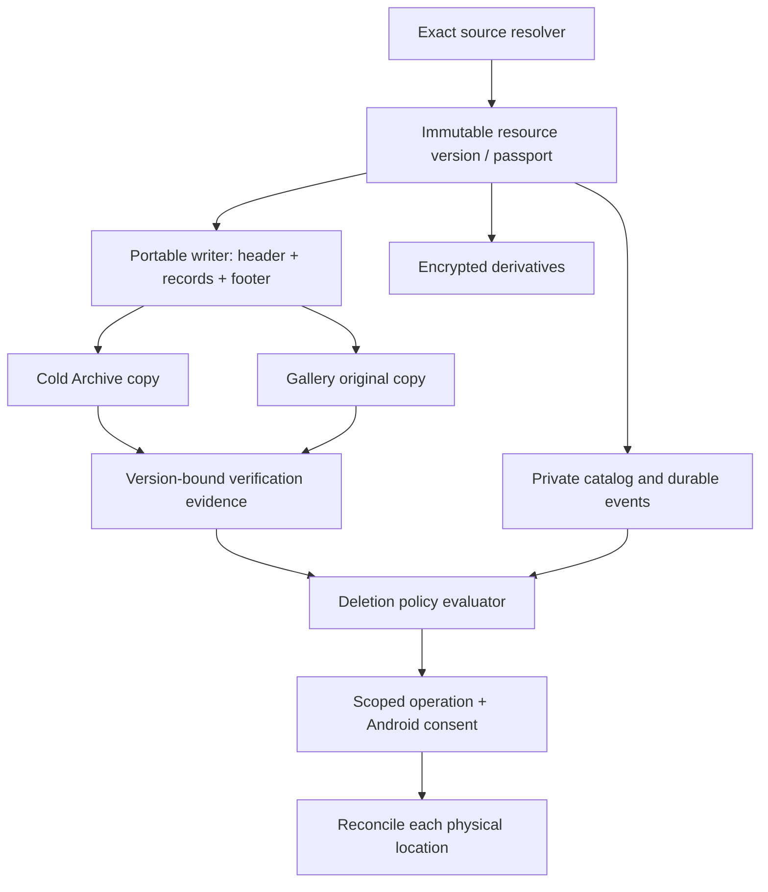

# Аудит архитектуры Android-галереи v26

Дата: 5 октября 2026 года.

Исходник: `gallery_architecture_working_v26.md` (private source document), 5961 строка.
SHA-256 исходника: `81f9ea41aa22dcbf8648482bf0d7900aea6d5439c7f5a517969cef95e2496e8b`.

Это аудит спецификации, а не проверка реализации. Производительность на Android, поведение аккаунтов Google/Yandex и совместимость декодеров не измерялись. Подтверждённые противоречия документа, выводы из сценариев отказа и предложения для экспериментов обозначены отдельно. Инструкции внутри исходника рассматриваются как требования к проекту, а не как команды для выполнения в этом чате. Исходный файл не изменён.

## 1. Оценка и принятые допущения

Архитектура содержит хорошую основу: сохранение исходных байтов, отделение оригиналов от производных, независимость хранения от поддержки декодирования, ограниченные очереди, keyset pagination, проверка облачной записи и восстановление после прерывания. Проблема находится прежде всего на стыках этих решений. Документ накопил несколько несовместимых моделей продукта и пока не годится как единая нормативная спецификация.

Для аудита последняя политика v25/v26 считается целевой: все долговечные облачные оригиналы — самодостаточные POB, восстанавливаемые без внешнего секрета; Gallery и Cold Archive имеют отдельные жизненные циклы; strict policy требует архивной копии до удаления локального оригинала. Это допущение для анализа, а не утверждение, что пользователь выбрал такую модель приватности окончательно.

Не считаю ошибками сами по себе: XChaCha20-Poly1305, Room 3, SQLCipher, Media3, Coil, packed thumbnails, ленивые previews или единый провайдер. Ошибка — приписывать этим механизмам гарантии, которых их композиция не даёт.

Приоритеты:

- **P0** — несовместимые требования или пробел в протоколе, который нужно устранить до его фиксации.
- **P1** — существенный риск потери данных, неверного состояния, приватности или несработавшего восстановления.
- **P2** — оптимизация и упрощение; решение принимается по измерениям.

## 2. Противоречия и блокеры протокола

### A01 — P0: E2E оригиналов несовместимо с восстановлением без секрета

**Где:** строки 13, 2615–2623, 5287–5294 против 5737–5792.

В ранней модели облако не может прочитать оригинал и EXIF/GPS. В поздней любой обладатель POB может восстановить оригинал без ключа. Это не проблема выбора шифра: декодер, которому хватает самого объекта, доступен и провайдеру.

v25 уже честно признаёт отсутствие конфиденциальности. Однако последствия не распространены на остальной документ:

- приватность встроенных EXIF/GPS тоже исчезает, даже если каталог зашифрован;
- locked background может скачать и восстановить старые POB, поэтому обещание «не может читать исторические оригиналы» перестаёт быть криптографической гарантией;
- «только ciphertext на диске» больше не означает, что локальная копия POB защищена секретом;
- зашифрованное зеркало не делает оригинал приватным, пока рядом существует копия без секрета;
- обфускация не гарантирует отсутствие облачного распознавания, индексации или антивирусной обработки.

**Исправление:** зафиксировать модель продукта в начале спецификации: «оригиналы доступны обладателю облачных объектов; приватные пользовательские структуры и производные защищены E2E». Либо выбрать отдельный режим, где безсекретной копии нет и восстановление требует RecoverySecret. При сохранении требования v25 нельзя рекламировать полную E2E-конфиденциальность медиатеки.

### A02 — P0: нет единственного действующего набора требований

**Где:** многочисленные `supersedes`, особенно v13, v22, v24, v25 и archive-first.

Последний текст меняет определения `isBackedUp`, оригинала, восстановления, удаления и ключей, но отменяет предыдущие разделы лишь частично. Например, v25 допускает backup по любому remote POB, тогда как прежние разделы требуют Gallery copy и committed catalog. Очередь strict режима то последовательная, то допускает параллельную загрузку.

**Исправление:** следующую версию написать заново как короткую нормативную спецификацию, а историю аудитов вынести в приложение. Для каждого правила дать ID, область действия и зависимость. Развести: обязательное правило, продуктовую настройку, рабочую гипотезу и параметр benchmark. Для уже сохранённых форматов отдельно определить migration/read compatibility. Более поздний абзац не должен неявно менять смысл опубликованного `Blob v1`.

### A03 — P0: полный SHA-256 в начальном заголовке ломает один проход

**Где:** строки 2476, 2894–2905, 2991–2994, 5848–5851.

AUDIT 12 правильно говорит, что SHA-256 неизвестен до чтения последнего байта. v13 помещает его в фиксированный encrypted header, который нужно сохранить до первой отправки. v26 сначала строит полный паспорт, затем POB, одновременно обещая один проход. Эти требования вместе невыполнимы для произвольного потока.

Заменить header после загрузки тоже нельзя без отдельного протокола: меняются ранее сохранённые байты, транспортные хеши и, при повторном AEAD с тем же nonce, возникает криптографическая проблема.

**Предпочтительное исправление:** immutable bootstrap header → поток записей → финальный footer с длиной, полным SHA-256 и манифестом. В header хранить только известные заранее поля; для неизвестной длины определить соответствующий флаг и framing. Завершённым объект становится только после footer и его проверки. Для encrypted working format footer получает отдельный nonce/domain и аутентификацию. Если оставить hash в начале, честно выбрать два прохода или полное staging.

Финальный паспорт разделить на дешёвый `SourceDescriptor` до чтения и `OriginalPassport` после успешного EOF. Медиа-диагностика не должна задерживать сохранение неизвестного формата.

### A04 — P0: один самостоятельный POB конфликтует с RemotePart

**Где:** строки 2960–2971, 3172–3192 против 5750.

Видео 100 GB разбивается на много объектов; порядок и диапазоны находятся в приватном каталоге. Отдельный surviving part не содержит весь оригинал и не знает весь набор частей. Условие «любой один blob восстанавливает весь оригинал без каталога» для такого размещения не выполняется.

**Исправление — нужен явный выбор:**

1. Строго один физический POB: поддержка ограничена максимальным объектом провайдера; слишком большие оригиналы нельзя обещать сохранить этим способом.
2. Практичный вариант: `PortableOriginalSet`, все части которого восстанавливаются без приватного каталога. Каждая часть содержит `setId`, номер/смещение, описание framing, собственную длину/хеш и достаточно информации для обнаружения отсутствующих частей. Финальный публичный манифест и общий hash дублируются по определённой политике.

Второй вариант сохраняет независимость от приложения, но требует всех необходимых частей. Формулировку «один любой файл содержит весь оригинал» придётся изменить. Обычный ZIP/ZIP64 с несжатым payload и манифестом тоже заслуживает сравнения с custom POB, если непрозрачность обычным просмотрщикам не является обязательным требованием.

### A05 — P0: strict последовательность + один проход + ограниченный spool несовместимы

**Где:** строки 5845–5855, 5869–5887.

Предположим, большой POB сначала полностью отправляется и проверяется в Archive, и только потом начинается Gallery. К моменту второй загрузки исходный поток уже прочитан. Без server-side copy остаются повторное чтение или сохранение полного POB. Маленький буфер не хранит произвольно большой файл.

**Исправление:** разнести две независимые настройки:

- `DeletionSafetyPolicy`: какие копии обязаны существовать до удаления;
- `UploadStrategy`: archive-first, parallel, server-copy, staged-parts.

Для хорошей скорости разрешить parallel upload с archive gate только на разрушительных действиях. Для реальной последовательности предпочесть проверенный server-side copy, затем проверку нового объекта. Если copy отсутствует, выбрать повторное чтение стабильного источника или staging ограниченных частей, каждая из которых доставляется в обе зоны до перехода дальше. Последний вариант уже не означает «сначала весь Archive, потом весь Gallery».

Отказ одной ветви не должен отменять подтверждённый успех другой. Нельзя привязывать скорость первой надёжной копии к самой медленной необязательной ветви.

### A06 — P1: hash внутри POB подтверждает согласованность, но не происхождение

**Где:** строки 5337–5343, 5789–5790, 5816–5824.

Для безсекретного формата атакующий может изменить payload и пересчитать встроенные chunk/full hashes. Даже AEAD с опубликованным ключом не даст защиты от такого атакующего. Изолированный файл с корректным SHA-256 не доказывает, что это исходные байты пользователя, а не согласованная подмена.

**Исправление:** разделить три уровня:

- checksum: обнаружение случайного повреждения;
- сравнение с доверенным паспортом: совпадение с ранее зафиксированным оригиналом;
- цифровая подпись и доверенная идентичность автора: защита от подмены паспорта.

POB может содержать подписанный паспорт. Но public key, вложенный только в тот же заменяемый файл, без внешней привязки не доказывает автора. Standalone recovery честно гарантирует восстановление байтов контейнера и внутреннюю проверку; hostile-provider authenticity требует доверенного каталога, отпечатка ключа или иного trust anchor. `FreeUpProof` обязан сравнивать с независимо доверенным исходным digest, а не просто принять hash, прочитанный из облачного POB.

### A07 — P0: writerEpoch не предотвращает два одновременно активных writer

**Где:** строки 34, 2721–2722, 2763–2787.

Два устройства читают epoch E, оба создают root-signed revision E+1, но с разными writer. Обе ветви криптографически правильные. Старый offline writer не узнает о takeover и может продолжать работать, особенно удалять облачные объекты с прежним OAuth. Подпись не отзывает облачные права.

**Исправление:** определить handoff-протокол с доказанной атомарной операцией провайдера или внешней координацией. Если такой операции нет, не обещать распределённую взаимоисключительность: операции добавления можно складывать в обнаруживаемые ветви, а разрушительные операции и GC при неизвестной актуальности/fork блокировать.

Takeover должен подписывать и `acceptedJournalHead`/checkpoint прежнего epoch. Старые записи до принятой границы остаются историей; поздние записи старого writer не входят в текущую ветвь автоматически. Правило «отклонять все old-epoch entries» без этой границы разрушит восстановление старых фото.

Особенно важно определить, что делает старое устройство после обнаружения takeover, и как сверяется authoritative head до каждой удаляющей сетевой операции. В обычном файловом облаке клиентская проверка сама по себе не превращается в server-enforced fencing.

### A08 — P0: две БД и NORMAL недостаточны для необратимых переходов

**Где:** строки 2025–2047, 2228–2232, 2270–2275, 2390–2404.

`synchronous=NORMAL` допустим для восстановимых индексов. Но в каталоге есть новые альбомы, избранное, исключения и tombstones, которых ещё нет в облаке. Worker содержит identities, crypto resume state и операции, уже вызвавшие внешний эффект. После power loss последняя локальная транзакция может исчезнуть, хотя сервер успел принять запрос. У двух WAL-баз нет общей атомарной транзакции. Это прямо следует из [документации SQLite о synchronous](https://sqlite.org/pragma.html#pragma_synchronous) и [транзакциях нескольких файлов](https://www.sqlite.org/tempfiles.html#super_journal_files).

**Исправление:** сохранить разделение по capabilities, но добавить durable outbox/operation log. Источник истины для пользовательской мутации записывается надёжно до её подтверждения и внешнего эффекта. Реконструируемые timeline/cache projections могут оставаться NORMAL; identity, exclusion, deletion intent и криптографическое состояние перед отправкой требуют durability barrier, например FULL для соответствующего журнала. Обновления между БД — через idempotent события и replay, а не предположение об атомарности.

Проверять нужно отдельно process death и power loss. Они не эквивалентны.

### A09 — P1: resume шифрования требует большего, чем metadata snapshot

**Где:** строки 2355–2368, 2390–2414, 2881–2890, 3002–3015.

Сценарий: первый вариант chunk был зашифрован и отправлен; источник изменился, но size/generation не отражают это ещё или ненадёжны; после сбоя chunk генерируется повторно с прежними key/nonce. Для нового plaintext это уже недопустимый повтор nonce. Длинный XChaCha nonce не спасает намеренный повтор одной пары. Требование уникальности описано в [libsodium](https://doc.libsodium.org/secret-key_cryptography/aead/chacha20-poly1305/xchacha20-poly1305_construction).

**Исправление:** resume из immutable staging текущей части; либо сохранять digest каждого уже использованного plaintext record и сравнивать повторно прочитанные байты **до** повторного шифрования. При несовпадении создавать новую identity/DEK/nonce, а не продолжать job. Нужные checkpoint данные должны стать durable до отправки. Если надёжного повторного получения прежних байтов нет, рестарт с новым криптографическим состоянием безопаснее.

Повторная отправка уже сохранённого ciphertext и воспроизведение того же record byte-for-byte допустимы; шифрование изменившегося record с прежним nonce — другой случай. Для keyless POB вопрос конфиденциальности иной, но тот же resume guard нужен для целостности; правило остаётся критичным для encrypted proxies/working originals.

Также before/after metadata check не создаёт атомарный snapshot файла. Изменение во время первого чтения способно дать поток из двух редакций. Если provider не гарантирует snapshot consistency, доказанная гарантия относится к байтам, фактически прочитанным успешным backup, а не обязательно к одной внешней редакции файла. Source resolver должен фиксировать уровень стабильности; перед уничтожением актуального источника нужно сравнение с этой версией. Не приравнивать MediaStore generation к криптографическому digest содержимого.

### A10 — P1: FreeUpLease берётся после proof, хотя должна предшествовать ему

**Где:** строки 4928–4939 против последовательности 4994–4999; строки 5660–5667.

Пока проверяется облачная копия, собственный purge/GC может её удалить. Кроме того, lease «на resource/store» недостаточна, если две операции независимо удаляют Gallery и Archive, каждая считая вторую копию страховкой.

**Исправление:** сначала атомарно зарезервировать разрушительную операцию и весь затрагиваемый resource-version/copy set, затем строить proof. Совместно вычислять состояние **после всех зарезервированных удалений**. Блокировки брать в постоянном порядке. Держать защиту до reconciliation фактического результата, включая незавершённый Android dialog. Перед каждой remote deletion проверять cancellation generation и актуальное право writer.

`restore cancels purge atomically` — недостаточно, если delete уже ушёл на сервер. Нужна state machine: до dispatch отмена; после dispatch — ожидание результата, сохранение другой копии/repair и восстановление, либо честный отказ, если байты действительно уничтожены.

### A11 — P1: proof TTL не контролирует время системного подтверждения

**Где:** строки 4894–4912, 4941–4948, 5007–5021, 5953–5958.

Пользователь может оставить Android consent открытым надолго. За это время изменятся источник или облако. `createDeleteRequest` удаляет URI при одобрении; спецификация не содержит условного удаления только ожидаемой версии. Проверка после result уже не возвращает уничтоженные новые байты. Ограничение remote race в исходнике признано правильно; аналогичную границу нужно признать для внешней мутации локального файла.

**Исправление:** считать гарантию «источник и удаляемая версия совпадали при preflight», а не математически атомарной. Где приложение имеет прямое право удаления, делать дополнительную проверку непосредственно перед delete. Где доступно, рассмотреть obtaining write consent → повторный preflight → управляемый delete, после проверки реального Android permission contract. Для системного permanent-delete dialog держать собственные leases до завершения и описать внешнюю гонку честно. Никакой локальный `SAFE` flag её не устраняет. Android подтверждает смысл и момент выполнения запроса в [MediaStore API](https://developer.android.com/reference/android/provider/MediaStore#createDeleteRequest(android.content.ContentResolver,%20java.util.Collection%3Candroid.net.Uri%3E)).

### A12 — P0: поздние state enums теряют критичные состояния и смысл safety

**Где:** строки 5135–5154, 5362–5405 против 5891–5907; определение backup в 5795.

Поздние enums удаляют `UNKNOWN`, `MISSING`, `CORRUPT`, source-changed, доступ к источнику и Gallery exclusion/Archive exclusion. `VERIFIED` не говорит, какую версию проверили, когда и с какими evidence. Один stored enum не может отразить одновременно transfer, existence, integrity, доступность и намерение пользователя.

**Исправление:** хранить независимые факты, а не ещё один огромный combined enum:

- immutable `ResourceVersion` и паспорт;
- `SourceAccess`/`SourcePresence`/`SourceVersion`;
- `UploadJobState`;
- `RemoteCopyPresence` и `VerificationEvidence`;
- `BackupIntent` по store;
- `Visibility`/`TrashRecord`;
- `DestructiveOperationState`.

`hasVerifiedColdArchiveCopy` — вывод из evidence для точной версии и выбранного account/root, а не boolean, установленный когда-то. `mayPermanentlyDestroy` нельзя вычислять только из размещения: требуется явное scoped intent пользователя и результат системы.

Разделить «точные байты есть в облаке», «Gallery восстановима с каталогом», «Archive complete», «strict policy satisfied», «offline/fast view ready». Archive-only item не должен выглядеть как полностью восстановимая Gallery, если альбомы/отношения потеряны.

### A13 — P1: ExactCopies может считать один объект дважды

**Где:** строки 5507, 5523–5527, 5723–5727.

`GalleryVaultOriginal + TrashRetainedExactCopy` иногда обозначают один и тот же provider object, которому поменяли логическую retention state. Аналогично два локальных alias/URI могут ссылаться на один файл. Простое сложение создаёт ложную резервную копию.

**Исправление:** `ExactCopyLocation` — уникальное физическое размещение полного resource-version. Trash — retention policy существующей location, если отдельная копия не создана. Set уникальных identities заменяет сумму booleans. Для split POB одна полная location — только весь набор проверенных parts.

Число физических копий, число логических ссылок и число failure domains — разные показатели. Две папки одного аккаунта защищают от scoped удаления Gallery, но не от потери аккаунта, общей квоты, провайдера или удаления обеих зон. Server-side copy даёт независимую lifecycle identity; независимые носители хранения провайдер этим не обещает.

### A14 — P0: 60-дневный purge конфликтует с запретом уничтожать последнюю копию

**Где:** строки 5520–5528, 5560–5586, 5727–5729, 5940–5945.

В Gallery-only режиме пользователь удаляет локальный оригинал и оставляет Gallery Trash. Через 60 дней автоматический purge удалит последнюю копию. По одному разделу это нормальная expiry; по другому её может удалить только explicit permanent-destruction action. Strict archive policy также не описывает судьбу уже созданных Gallery-only trash items после включения strict.

**Исправление:** при создании TrashRecord фиксировать, является ли действие разрешением на будущую permanent deletion, точный scope и политику на expiry. Выбрать один контракт: либо обычная Trash заранее разрешает purge после 60 дней, либо last-copy purge блокируется и просит соответствующее явное действие. Не менять этот смысл неявно при новой настройке vault.

Офлайн background не даёт точного удаления на 60-й день: можно обещать «хранить не менее 60 дней, затем удалить при следующей возможности». Для строгого срока нужен иной исполнитель. У local-only offline item можно скрыть запись, сохранив исходный файл; нельзя обещать освобождение места и облачное undo без созданной копии. Локальный retained trash, если выбран, — durable store, не cacheDir.

### A15 — P1: GC «не referenced каталогом» опасен для самостоятельного архива

**Где:** строки 3342–3351, 1503–1510 против 5750, 5764, 5638.

Для derivative pack orphan допустимо удалить. Но полный валидный POB может быть единственной долговечной копией, даже если catalog commit потерян. Безсекретный архив заявлен независимым от каталога; удалять его как обычный orphan по отсутствию приватной ссылки противоречит этому свойству.

**Исправление:** разделить незавершённое staging, sealed-but-uncommitted originals, committed Gallery payload и Archive originals. Archive не очищать по одной приватной reachability scan. Sealed exact originals после сбоя сперва reconcile/adopt/quarantine по immutable operation identity; GC требует явного lifecycle evidence. Grace period снижает вероятность гонки, но не заменяет знание состояния writer и полную проверку ссылок.

Для snapshots: загрузить и проверить новый snapshot, закрепить точный journal head, проверить восстановление, только затем удалять покрытую историю по протоколу. Хранить предыдущий пригодный checkpoint. Tombstone GC должен учитывать старые устройства и ветви, а не лишь время жизни записей.

## 3. Android, каталог и восстановление

### B01 — P1: «доступа нет» нельзя превращать в «файла нет»

**Где:** строки 57–60, 2035, 2198–2203, 4801–4803, 5896.

На partial access часть файлов исчезает из результата запроса, хотя физически существует. SD-карта может быть отключена; SAF permission отозвана. Mark-and-sweep по `lastSeenScanEpoch` без scope/version проверки ошибочно пометит тысячи оригиналов deleted/absent. Даже пустой ответ не означает успешный полный scan.

**Исправление:** отдельные `ACCESS_REVOKED`, `PARTIAL_SCOPE`, `VOLUME_OFFLINE`, `PROVIDER_UNAVAILABLE`, `ABSENT_CONFIRMED`. Публиковать итог полного scan только после завершения в том же volume-version/access-scope. Периодическое отсутствие не является пользовательским delete и не должно запускать cloud purge. Android отдельно предупреждает об изменяемых и временных grants в [partial photo/video access](https://developer.android.com/about/versions/14/changes/partial-photo-video-access).

### B02 — P1: идентичность MediaStore должна включать эпоху volume database

**Где:** строки 59, 2035, 2198–2203.

`UNIQUE(volumeName, mediaId)` недостаточен после reset/rebuild MediaStore: прежний ID может начать обозначать другой файл. Простая смена generation без версии базы тоже ненадёжна.

**Исправление:** source binding включает provider authority, volume, MediaStore version/epoch, ID и source-version evidence. При смене version все прежние привязки становятся требующими сверки. Source ID не равен Resource identity. Hash+length помогают перепривязать точную версию после чтения, но не должны автоматически объединять два пользовательских Asset.

### B03 — P1: exact original acquisition описан неполностью

**Где:** строки 2327–2338, 4358–4362.

`setRequireOriginal` и доступ к location metadata важны, но отсутствие typed decoder path само по себе не доказывает, что Android никогда не вернёт transcoded representation. API 31 имеет отдельный `getOriginalMediaFormatFileDescriptor`; получение original format и снятие EXIF redaction — разные вопросы. Это описано в [MediaStore](https://developer.android.com/reference/android/provider/MediaStore#getOriginalMediaFormatFileDescriptor(android.content.Context,%20android.os.ParcelFileDescriptor)) и [compatible media transcoding](https://developer.android.com/media/platform/transcoding).

**Исправление:** единый `ExactSourceResolver` с API-specific contract и evidence `EXACT_ORIGINAL`, `REDACTED`, `TRANSCODED`, `PROVIDER_REPRESENTATION_UNKNOWN`. Для SAF/cloud picker не утверждать происхождение «как на камере», если доступен только поставляемый поток. Архивировать поток можно, но exact/free-up claim должен относиться к доказанной исходной representation. Проверять pending/trash state, реальный EOF и byte count, а не только MediaStore SIZE.

### B04 — P1: worker и private catalog не имеют описанного протокола согласования

**Где:** строки 2032–2038, 2468, 2542–2554, 3325–3335.

Locked background пишет sealed journal, но не открывает каталог. Нужно определить, кто выдаёт asset identity, как находить exclusion без private DB, как объединять новый resource с Asset, как UI получает результат после unlock и когда можно уничтожить transient job key. Иначе возможны дубликаты, resurrection и потеря update.

**Исправление:** worker содержит минимальные projection exclusions и source bindings, подписанные версии мутаций и outbox. Каталог после unlock idempotently применяет committed events; locked worker не редактирует private snapshot. Для составных Asset — явный resource-set revision и commit group. Сохранение байтов resources может завершаться независимо, но «полный Live Photo backup» требует всей текущей группы.

### B05 — P1: keyless recovery файлов не восстанавливает весь пользовательский результат

**Где:** строки 4186–4189, 4263–4279, 5636–5638, 5740–5750.

Два standalone POB могут вернуть still и MOV, но потеряется доказанное pairing, sidecar association, original filename, capture-date correction, albums, favorites или недеструктивные edit recipes. Особенно если это есть только в encrypted catalog. Исходник признаёт часть ограничения, но v25 обещает общий формат для всей disaster recovery слишком широко.

**Исправление:** документировать два результата: `recover exact resource bytes` и `restore gallery semantics`. Минимальный portable resource manifest хранит имя/расширение, роль, resource-set ID и версию связи, если это входит в безсекретное recovery requirement. Всё такое metadata в POB также доступно провайдеру. Альбомы/редактирования — отдельные user-authored authoritative metadata, их нельзя объявлять disposable derivatives. Если их восстановление без ключа не требуется, прямо указать границу.

### B06 — P1: bootstrap доверия, key rotation и rollback требуют точных правил

**Где:** строки 2663–2681, 2763–2787, 3060–3070.

Проверка цепочки под public key из самой цепочки недостаточна для идентификации правильного vault. После unwrap VRS следует проверить совпадение вычисленных root/wrap public keys с claimed keys и ожидаемым vault binding. Нужно определить anchor на уже использованном устройстве.

Замена RecoverySecret не отзывает старую копию recovery wrapper у атакующего; root secret остаётся тем же. Отзыв writer certificate не отзывает знакомый устройству VRS и доступ к старым оригиналам. Fresh install не обнаружит полностью согласованный rollback без независимого freshness anchor — это исходник признаёт правильно.

**Исправление:** раздельно описать rotation local password, recovery slot, writer auth, root encryption identity и provider OAuth. Для confidentiality revocation приватных объектов нужна ротация соответствующего ключевого материала/перевыпуск wrappers с понятной границей старых данных. POB без секрета вообще не может быть отозван криптографически.

### B07 — P1: удаление plaintext/key material не равно полному физическому стиранию

**Где:** строки 1451, 2661, 2875–2878, 4530, 5230–5232.

На lock мало закрыть catalog DB и wipe PackKey. Decoded Coil images, viewer pins, tiles, player buffers, GPU surfaces и незавершённые tasks могут сохранить содержимое и вернуть результат уже после lock. SQL row deletion может оставить старые wrapped DEKs в WAL/pages; encrypted pack всё ещё содержит удалённый thumbnail, а retained PackKey его раскрывает.

**Исправление:** общий `UnlockSessionId`; на lock отменять запросы, закрывать UI surfaces, очищать decoded caches и проверять session generation перед публикацией результатов. Действующие share leases — явно документированное исключение. Пер-resource/session secrets уничтожать best-effort с учётом WAL; не обещать forensic erasure. Для immediate private-derivative erasure могут понадобиться compaction и новая pack key либо иная key granularity. Physical provider versions/trash тоже отделить от app-level purge.

### B08 — P1: tombstone/exclusion должны переживать тот отказ, от которого защищают

**Где:** строки 5181–5186, 5663–5680.

Локальная exclusion, за которой сразу удалили remote object, исчезнет после uninstall или потери БД. Scan заново загрузит то, что пользователь удалил. Если tombstone только по source URI, re-import под новым URI его обойдёт; если по hash, можно неожиданно подавить намеренный новый импорт одинакового файла.

**Исправление:** удаляющий intent сначала durable и, где нужен reinstall guarantee, committed remotely. Развести suppression конкретного resource identity и content-based exclusion; explicit re-import получает новую разрешённую revision. Отдельно определить recovery archive exclusions при полной потере private keys: независимые POB не содержат историю удалений автоматически. Нельзя обещать восстановить секретный tombstone, когда весь секретный каталог недоступен.

### B09 — P1: экспортный hash на выходе writer не доказывает прочитанные destination bytes

**Где:** строки 4634–4659.

Hash того, что отправили в OutputStream, подтверждает передаваемый поток. Он не доказывает, что SAF cloud provider сохранил эти байты, завершил remote upload или не изменил их. Даже локальный `fsync` нужен по реальному contract destination, а SAF не обязан его поддерживать.

**Исправление:** отличать `stream verified`, `destination committed` и `destination read-back verified`. Для обычного Export можно гарантировать проверенный поток и успешное закрытие destination; повышенная гарантия требует reopen/readback и сравнения, если capability доступна. На crash сохранять pending export identity для cleanup/reconcile. Unknown bytes экспортировать в documents path, если MediaStore collection не подходит.

### B10 — P1: быстрый restore требует формата snapshot и согласованного journal head

**Где:** строки 67, 815–832, 2257–2266, 3325–3340.

Обещание показать пригодный каталог раньше остальных данных требует описания самого snapshot. Если весь snapshot защищён одним AEAD record, нельзя доверенно публиковать его начало до проверки финального tag. При sharded snapshot нужно знать согласованный набор частей и revision, а не смешать таблицы из разных checkpoints.

**Исправление:** аутентифицированный bootstrap manifest с snapshot identity, accepted root/journal head, counts, shard identities/hashes и диапазонами timeline. Небольшие независимо проверяемые snapshot shards позволяют сначала загрузить hot rows и visible window; journal tail применяется относительно того же head. `RestoreProgress` отделяется от `Visibility` и `SafetyHydrated`. До загрузки resource descriptors, exclusions, tombstones и pending destructive operations нельзя запускать GC/Free Up на основании частичной ленты. Missing referenced original означает damaged backup; missing derivative — только degraded viewer readiness.

## 4. Cloud, share и media integration

### C01 — P1: отсутствие по path не доказывает удаление нужного объекта

**Где:** Yandex adapter 3266–3296; операции удаления 5184–5186, 5222–5234.

Yandex path может быть переименован/перемещён; ACL/OAuth loss может сделать объект недоступным. `404` по прежнему path не всегда доказывает, что именно прежний object физически уничтожен. Это важно для exact-copy enumeration и `Erase every stored copy`.

**Исправление:** сохранять provider stable identity, когда она доступна, вместе с path и content evidence. Состояния `NOT_AT_EXPECTED_PATH`, `ACCESS_DENIED`, `UNKNOWN`, `ABSENT_CONFIRMED` различать. Async copy/delete требуют ожидания операции и reconciliation результата. Copy на Google тоже получает заранее записанную target identity и обработку ambiguous timeout; Drive документирует pre-generated IDs для create/copy/upload в [upload guide](https://developers.google.com/workspace/drive/api/guides/manage-uploads).

Текущие гарантии Yandex Range/resume/SHA-256 в этом аудите не подтверждены интеграционным тестом. Осторожная capability-probe модель исходника уместна. Публичные подробные страницы Yandex meta/copy не были доступны через использованный web-инструмент; это не доказательство отсутствия API.

### C02 — P1: evidence должна привязываться к версии объекта и включать downloadability

**Где:** строки 3194–3220, 4894–4924, 5802–5812.

`sha256Checksum` Google — поле `if available`, а не безусловный ответ каждого metadata request. Version может измениться из-за metadata без изменения content; само по себе это повод invalidate/revalidate evidence, а не доказательство corruption. Наличие metadata не доказывает, что download разрешён. См. [Drive files resource](https://developers.google.com/workspace/drive/api/reference/rest/v3/files).

**Исправление:** `VerificationEvidence` содержит copy identity, content digest, byte length, observed version/revision, verification method/time, trusted OriginalPassport digest и состояние доступности. При отсутствии server hash — readback. При full readback stat/version до и после и привязка всех range responses к неизменной версии, где возможно. Смешанный read разных revisions не должен стать VERIFIED.

Server hash и round-trip — разные проверки: первая проверяет записанный контейнер, вторая ещё проверяет его recovery/crypto mapping. Это не вечная гарантия retention.

### C03 — P1: HTTP Range нужен как точный контракт

**Где:** строки 1341–1351, 3542–3551, 3386–3388.

Правильного кода 206 недостаточно: нужны ожидаемые start/end/total в Content-Range, exact received byte count и object identity. HTTP transparent content encoding может испортить адресацию. При cached corruption бесконечный evict/refetch loop съест трафик.

**Исправление:** transport возвращает проверяемый `RangeResult`, запрещает незапрошенные representation transforms, поддерживает bounded retries и различает 200 whole-object fallback, 416 и truncation. Cache key включает vault/account/copy generation/content identity; mutable provider path сам по себе не ключ. Redirects capability URLs не должны переносить OAuth headers на произвольный host.

### C04 — P1: direct MediaStore URI — неподходящая безусловная гарантия Original Exact share

**Где:** строки 4503–4507, 4546–4556.

Получатель открывает MediaStore с собственными permissions/media capabilities. Из того, что наше приложение могло читать original, не следует, что recipient получит ту же unredacted/untranscoded representation. Источник также может измениться после подготовки share.

**Исправление:** `Original file / Exact` по умолчанию отдавать через собственный provider над зафиксированным resource-version. Direct MediaStore URI оставить как оптимизацию только при доказанном target/API contract. При необходимости сначала bounded/full materialization стабильной exact copy. Для keyless POB ShareLease защищает device authorization и lifespan, но не секретность облачного оригинала.

Lease проверять и на open, и на каждом callback read; у уже открытого FD отдельный жизненный цикл. Отзыв URI не отзывает байты, уже скопированные получателем. Облачные callbacks должны иметь timeout/cancellation, bounded workers и избежать deadlock, если тот же Handler нужен для завершения download. On-read network не гарантирует непрерывную работу после background ограничения или process death — это отдельный compatibility test.

### C05 — P1: fMP4 сам по себе не гарантирует seek

**Где:** строки 3826–3838, 3859–3872, 3988–3997.

Fragmented container и поддержка seek map — разные свойства. В современных Media3 добавлена поддержка `mfra`, но для неё нужен сам индекс и соответствующий extractor path. Поэтому нельзя ни считать fMP4 автоматически seekable, ни утверждать, что Media3 всегда его не умеет. Изменение описано в [Media3 release notes](https://developer.android.com/jetpack/androidx/releases/media3).

Кроме того, duration fragment при sample-copy зависит от существующих sync samples: настройка 2 seconds не создаёт keyframes. Текущий исходник [FragmentedMp4Muxer](https://raw.githubusercontent.com/androidx/media/release/libraries/muxer/src/main/java/androidx/media3/muxer/FragmentedMp4Muxer.java) отдельно предупреждает об увеличении фактической длительности и ограничении out-of-order B-frames. Это делает generic remux fallback предметом проверки, а не готовой гарантией.

**Исправление:** фиксировать muxer/extractor versions и проверять готовый proxy: есть пригодный index, duration, random seek по всей длине, B-frame/VFR playback, keyframe semantics. Если нужен streaming fMP4, определить генерацию `mfra`/иного поддержанного индекса; иначе выбрать обычный indexed MP4 или иной подтверждённый путь. `ProxySeekHints` не становятся Media3 SeekMap автоматически — нужен явный adapter, если на них рассчитывают.

Crypto record boundaries и media fragment boundaries обычно не совпадают. Не обещать оба alignment сразу без изменения framing/padding. Media fragment может пересекать RemoteParts; reader обязан прозрачно соединять байты.

### C06 — P1: streaming proxy output имеет неизвестную итоговую длину

**Где:** строки 2899–2903, 3826–3857, 4579–4593.

При transcoding заранее неизвестны total plaintext size и SHA-256. Original Blob header format не может без изменений обслужить такой writer. Network backpressure внутри synchronous muxer/codec callback способен затормозить или заблокировать всю encoder pipeline.

**Исправление:** отдельный streaming derivative writer с footer/final descriptor; bounded encrypted local staging, затем независимая upload stage. Ограничивать очередь samples/codec buffers, а не только сетевой byte ring. При заполнении диска прекращать generation, сохраняя source и понятный retry. Не обещать продолжить transcoding с произвольного байта после crash: baseline — restart disposable derivative, новая identity/key/nonces.

### C07 — P2: proxy FD — кандидат для image decode, который пропущен

**Где:** строки 131–137, 277–281 против 4477–4501.

Верно, что BitmapRegionDecoder не принимает произвольный Media3 DataSource. Но уже выбранный `openProxyFileDescriptor` возвращает seekable descriptor, а region decoder имеет FD/PFD constructors. Android прямо описывает [proxy FD для on-demand decryption](https://developer.android.com/reference/android/os/storage/StorageManager#openProxyFileDescriptor(int,%20android.os.ProxyFileDescriptorCallback,%20android.os.Handler)) и [FD inputs region decoder](https://developer.android.com/reference/android/graphics/BitmapRegionDecoder).

**Предложение для прототипа:** использовать общий random-access reader → proxy FD → platform decoder для поддержанных форматов. Это может убрать часть plaintext-temp fallback и native codec scaffolding. Это гипотеза, не доказанная эффективность: decoder может читать большой префикс/весь encoded stream, держать собственную копию и не давать экономии Range. Проверять bytes read, RAM и decode latency. Для RAW/JXL/огромных изображений tiled derivatives по-прежнему могут быть нужны.

### C08 — P1: magic и spec identifier не обеспечивают recovery без документации

**Где:** строки 5313–5337, 5740–5749, 5779–5787.

В условии потеряна и внешняя спецификация, но header допускает просто `spec identifier`. Ссылка или название transform не описывают точные counter/nonce rules, byte order, framing, checksum coverage и поведение последнего chunk. «Будущая AI догадается» — непроверяемая гарантия.

**Исправление:** выбрать максимально простой payload representation и закрепить полностью нормативный bootstrap recipe с версиями всех используемых примитивов. Отдельно иметь reference decoder, independent decoder и immutable golden files; проверить offline recovery только по информации, действительно включённой в объект. Если нужно скрыть обычный media signature, публичный обратимый transform остаётся исключительно обфускацией и добавляет собственный риск совместимости. Никакой reader не должен автоматически выполнять вложенный script или сетевые инструкции из recovery header: описание читается как данные, parser ограничивает lengths/allocations и отклоняет unsupported formats.

## 5. Производительность и лишняя сложность

### D01 — P1/P2: приоритет speculative prefetch выше явного user action неверен

**Где:** строки 101, 858–868, 4782–4788, 5878–5879.

Если N±1 prefetch всегда выше Share/Export, постоянные swipes могут голодать явно выбранную операцию. Глобальная очередь также смешивает разные ресурсы: UI decode не обязательно должен отменять полезную network upload.

**Исправление:** порядок для конкурирующего ресурса: current visible/playback → explicit user action → bounded adjacency prefetch → authoritative backup → derivative warm-up → maintenance. В background lanes — aging и минимальные квоты прогресса. UI получает reserved capacity, но prefetch не может бесконечно блокировать backup. «Preempt decode» реализуется отменой очереди/непубликацией stale результата; native decoder не обязательно прерывается мгновенно.

Archive preference применяется внутри background authoritative lane, а не выше всех UI reads и не как запрет дешёвого thumb bootstrap.

### D02 — P2: сначала считать полную стоимость проверки

**Где:** full round-trip proof 5101–5109, 5682–5695 и archive-first.

Для N байтов исходников две uploads + два full remote readbacks дают примерно `2N upload + 2N download`, плюс derivatives и retries. С server-side copy клиент может отправить N один раз, но самостоятельная проверка второй копии всё ещё стоит чтения, если именно такой уровень требует policy. «2× cloud storage» не отражает сетевую цену.

Опциональная полная encrypted working-original copy поверх Gallery POB и Archive POB увеличивает original storage примерно до `3N`. Локально POB staging без внешнего секрета тоже нельзя включать в обещание «только секретно зашифрованные bytes»: при необходимости дополнительной device privacy нужен отдельный локальный storage wrapper, который не меняет облачный portable format.

**Исправление:** выполнять первый round-trip в bounded queue после upload, сохранять evidence и переиспользовать её для той же подтверждённой content identity. Перед Free Up делать metadata/version revalidation; full reread нужен после invalidation либо при режиме always-readback. Если v25 буквально требует full read на каждое действие, это отдельный дорогой режим, а не невидимая оптимизация.

В UI показывать: «байты загружены», «проверка восстановления», «Gallery copy pending», «можно освобождать». Не показывать total backup complete на одном upload callback.

### D03 — P2: thumbnails offline и мгновенное открытие всей библиотеки — разные бюджеты

**Где:** строки 43–45, 1276–1285, 1695–1699.

Bounded preview LRU не позволяет гарантировать local full-screen preview для любого старого asset. ThumbHash/малый thumb может дать первый кадр без облака, но sharp viewer frame может ждать download. «FastViewReady есть в local или cloud» тоже не означает готовность offline.

**Исправление:** отдельно измерять first feedback frame и first sharp frame. Отдельно хранить `RemoteViewReady`, `LocalPreviewReady`, `OfflineOriginalReady`. Thumbnails, которым обещана постоянная offline residency, размещать в durable filesDir/noBackup store с явной storage policy; evictable preview/range — cache. Keep Offline — pin с reservation, а не недоступный для eviction объект без контроля места.

Иллюстрация бюджетов, не прогноз: 100k thumbs по 20 KiB ≈ 1.91 GiB; 500k ≈ 9.54 GiB. Всего три decoded previews 2560×1920 RGBA8 ≈ 56.25 MiB; RGBA_F16 — вдвое больше. К этим значениям добавляются decoder intermediates, video samples, tiles и GPU/native memory.

### D04 — P2: partial THUMB_PACK download может повторно качать полезные байты

**Где:** строки 1353–1370, 1555–1571.

Range только в RAM, затем full pack с начала — повторная передача тех же spans. Несколько прыжков по старым датам плюс «complete corresponding pack» могут выкачать всю библиотеку по metered network.

**Исправление:** сначала измерить это на traces. Простой intermediate вариант — один partial pack file плюс bitmap проверенных fixed blocks; либо общий существующий range cache. Завершение whole pack зависит от доли полезных fetched bytes, network policy, свободного места и offline intent. Не добавлять sparse format только по догадке; но и не обещать эффективно «докачать» то, что нигде не сохранили.

При объединении диапазонов ограничивать debounce, gap bytes и overfetch ratio, различать отмену отдельного потребителя и отмену shared request. Ушедшая cell не должна отменять coalesced read, нужный оставшимся cells. Demand request может повысить приоритет уже выполняющегося prefetch.

### D05 — P1/P2: date bucket не обязательно непрерывен в timeline order

**Где:** строки 1988–2005, 2071–2072, 2128–2143.

Если sort key — UTC instant, а day_key — локальная дата каждого источника с разными timezones, один day bucket может распадаться на несколько фрагментов. Prefix counts по дням тогда не соответствуют absolute ranks. Смена timezone устройства тоже может сдвинуть группировку, хотя captureSortKey остался прежним.

**Исправление:** выбрать фиксированную date/grouping семантику: capture civil date с documented timezone provenance либо единый timeline timezone и совместимый sort key. Bucket должен соответствовать непрерывному интервалу полного ordering key. Date corrections, unknown dates и DST — отдельные fixtures. Альбомы/filters требуют собственных count/anchor projections; глобальный DateBucketIndex не подходит произвольному filtered timeline.

Внутридневные sparse anchors тоже сдвигаются при insert/delete. `timelineGeneration` не сохраняет старый DB snapshot автоматически. Нужен retained window/версионированный index, отложенный generation swap на gesture или явное re-anchor. Нельзя держать длительную read transaction без контроля WAL growth.

### D06 — P2: ThumbHash в БД не означает ThumbHash уже в RAM

**Где:** строки 1939–1945, 2007–2010.

До загрузки target metadata page известны rank/day, но не placeholders всех произвольных target cells. Одновременно обещать «zero DB I/O» и exact ThumbHash новой страницы нельзя без дополнительного RAM index.

**Исправление:** тотчас рисовать fixed geometry и простой цвет/representative day placeholder из RAM. Индивидуальный ThumbHash появляется после bounded DB window load. Это сохраняет мгновенный scrub feedback без обещания отсутствующих данных.

### D07 — P1/P2: memory budget должен учитывать peak, а не только bitmap output

**Где:** строки 565–567, 1663–1668, RAW/tiles 4170–4182, pipeline 4815–4819.

`targetWidth×targetHeight×Bpp` не включает encoded buffers, full-resolution intermediates, RAW demosaic, gain map, codec samples, native allocation, hardware bitmap и GPU texture. Target-size API не гарантирует, что каждый backend избежит внутреннего большого decode. Генерация tiles не должна делать отдельное full RAW develop для каждого tile.

**Исправление:** один global memory admission controller с estimates по decoder/format, peak native/GPU/PSS measurements и hard bounds на размеры/frames/auxiliary items. Отдельные storage/decode/network tokens дополняют этот общий предел. Для 100–200 MP sources нужен конкретный memory-bounded tile generation backend; иначе не обещать no-OOM для неподдержанного формата. Все parsers/native decoders рассматривают вход как недоверенный: overflow, decode bombs, XMP entities, CPU timeout, cancellation, malformed containers.

### D08 — P2: разные cache budgets нужны, но столько отдельных систем может быть лишним

**Где:** cache sections v2–v6, AE.9/AE.17, share cache.

Разделение budgets правильно, но независимые range stores для video, POB, tile packs, thumb packs и share создадут разные implementations retry/integrity/eviction и несколько копий тех же bytes. Дополнительные decoded viewport pins способны дублировать Coil cache references/ownership.

**Исправление:** общий `OriginalReader/VerifiedRangeReader`, единые transport/copy identities и range storage infrastructure, разные admission classes и quotas. Coil остаётся владельцем обычных decoded images; viewport pin учитывается в том же memory budget. Safe custom decoder path сохраняется. SimpleCache не обладает всеми желаемыми probation/no-persist prefetch semantics автоматически: нужны explicit flags/data sink policy или отдельный transient path. Проверить cache ownership, encryption-sensitive index metadata и отсутствие plaintext temp fallback на pinned Coil версии.

Начать с LRU/2Q, затем сравнивать лишь кандидаты, решающие обнаруженную проблему. Выбор FIFO-family, mmap, hardware bitmap policy и codec не должен блокировать корректный core backup.

### D09 — P2: journal object count может свести на нет выигрыш thumb packs

**Где:** строки 2740–2761, 3329–3335 против thumbnail packing 1287–1318.

Для каждого Asset описан отдельный immutable journal object и отдельная его cloud verification. На больших библиотеках это добавляет сотни тысяч metadata/create/get/list операций сверх оригиналов и previews. Packed thumbnails уменьшают только одну часть общей стоимости; fresh restore всё равно должен найти и воспроизвести историю.

**Исправление:** сравнить immutable journal segments с независимо signed entries и подписанным segment/head descriptor. Seal по bytes/max-age/worker-stop; commit считается durable только после проверки содержащего его segment. Snapshot ограничивает объём необходимого tail replay. Не ждать большой полной пачки для единственного нового снимка или Free Up — max-age/explicit flush обязательны. Измерять provider API calls per committed asset, writer Keystore signing latency и time-to-recover head; не менять подписи/commit semantics ради одного уменьшения object count.

### D10 — P2: singleton базы не должен означать одну физическую connection

**Где:** строки 2031, 2048, 2051–2063, 2240–2245.

Один `RoomDatabase` на session — разумный lifetime. Буквально одна SQLite connection на все read/write операции может сериализовать timeline queries за restore/import и лишить WAL ожидаемой выгоды. SQLCipher setup overhead не означает, что bounded connection pool нужно запретить.

**Исправление:** один database instance с контролируемым reader pool и одним writer, корректной инициализацией SQLCipher каждой connection и короткими transactions. Размер pool подтвердить одновременным timeline+import trace. Local rowid годится для DB joins, но его reuse нельзя объявлять безусловно безвредным для Compose selection, remembered state и delayed callbacks: для долгоживущей UI identity использовать opaque assetId либо generation-qualified local key.

### D11 — P2: EXPLAIN regression нельзя сводить к поиску слова SCAN

**Где:** строки 2116, 2296–2303.

Ordered index scan для первой страницы с LIMIT может быть правильным и быстрым; `SCAN` не всегда означает полный проход по всем asset rows. Текстовый вывод EXPLAIN также меняется между SQLite versions. Слишком буквальный тест отклонит нормальный query plan или создаст ложную уверенность в сложном filter query.

**Исправление:** проверять подходящий access path, отсутствие ненужной полной сортировки и реальное масштабирование latency/visited rows с глубиной и selectivity. План — диагностический сигнал вместе с benchmark, а не стабильный текстовый API. Сохранить row-value keyset как baseline, но подтвердить его на выбранном SQLCipher SQLite build и реальных hot DAO queries.

## 6. Предлагаемая согласованная модель

При сохранении keyless-original requirement архитектуру полезно собирать вокруг пяти сущностей:

```text
Asset
  presentation identity, visibility, user metadata, resource-set revision

ResourceVersion
  immutable resourceId/version, byteLength, SHA-256, source representation

ExactCopyLocation
  resourceVersionId, store, providerAccount/root, physical copy/set identity,
  parts, retention, presence, verification evidence

DerivativeVersion
  sourceResourceVersion, profile/codec/version, encrypted representation,
  regeneration capability, local/cloud residency

Operation
  immutable operationId, intent/scope, cancellation generation,
  durable outbox, dispatch/reconciliation progress
```

Store — local source, Gallery original, Cold Archive original или отдельный local retained exact copy. Trash меняет retention location, если новый физический объект не создавался. `ResourceVersion` меняется при изменении исходных байтов; старый подтверждённый backup не становится подтверждением новой версии.



Стрелки в две cloud zones не предписывают конкретную последовательность: она выбирается UploadStrategy. Политика удаления применяется к facts после проверки, а не к выбранному upload algorithm.

Пример нормализованной evidence:

```text
VerificationEvidence {
  resourceVersionId
  originalByteLength, trustedOriginalSha256
  copyId, providerAccountId, vaultRootBinding
  containerFormatVersion, containerBytes, containerSha256
  orderedParts: identity, range, size, digest, observedRevision
  method: SERVER_DIGEST | FULL_CONTAINER_READBACK | FULL_RECOVERY_READBACK
  verifiedAt, observedDownloadability
  invalidationGeneration
}
```

Это факты наблюдения, не утверждение о вечном существовании copy. Историческая verification evidence сохраняется для диагностики, а текущая пригодность вычисляется.

### Условие Free Up для strict режима

```text
mayRequestFreeUp(asset, operationContext) =
  userRequestedThisScope
  AND currentWriterIsAcceptedAndNoForkIsKnown
  AND mutationReservationHeld
  AND allRequiredResourceVersionsHaveStableMatchingLocalSources
  AND allRequiredResourceVersionsHaveFreshExactColdArchiveEvidence
  AND allRequiredResourceVersionsHaveFreshExactGalleryEvidence
  AND recoverableGalleryCatalogCommitExists
  AND plannedRemainingLocationsSatisfyPolicy
```

Gallery evidence здесь требуется именно для normal Gallery Free Up; самостоятельная «удалить с устройства, оставить только в архиве» — отдельная операция. Archive-only safety не доказывает готовность рабочей Gallery. Preview readiness добавляется как UX policy, а не как proof оригинала.

Условие проверяет всё множество authoritative resources, а не `any()` одного ресурса. Если половина Live Photo недоступна, asset aggregate state — partial. Переход источника в ABSENT выполняется только по наблюдаемому результату, а не потому, что worker отправил delete request.

### Минимальный порядок разрушительной операции

1. Зафиксировать exact intent, targets и exclusions в durable operation log.
2. Получить reservation на resource versions и все затрагиваемые copy locations.
3. Подтвердить writer/head и собрать свежие evidence.
4. Вычислить оставшиеся копии с учётом других pending mutations.
5. Подготовить ограниченный Android URI batch, не выдавая proof следующего batch заранее.
6. Запросить consent/удалить по доступному platform contract.
7. Reconcile каждую location, включая ambiguous timeout и process recreation.
8. Зафиксировать результат и только затем освободить reservation.

Это saga с idempotent шагами, а не атомарная транзакция Android+cloud. Failed/cancelled consent не должен неявно приводить к удалению других копий, если scope требовал их совместного уничтожения.

### Действия пользователя и обязательные границы

| Действие | Что меняется | Что обязательно сохранить/проверить |
|---|---|---|
| Скрыть из ленты | Visibility | Originals не затрагиваются |
| Освободить устройство | Local presence | Exact Gallery, а в strict и Cold Archive; catalog; source version |
| Удалить Gallery copy, оставить на устройстве | Gallery copy + exclusion | Проверенная оставшаяся exact location и соответствие обещанному scope |
| В корзину | Visibility + retention + intent | Undo contract; срок и будущий purge scope |
| Удалить Archive copy | Archive location + exclusion | Last-copy policy и отдельное явное действие |
| Восстановить из корзины | Visibility/retention | Отмена ещё не dispatched purge или repair после результата |
| Стереть перечисленные копии | Scoped permanent-destruction operation | Полный список известных locations; provider trash/versions отдельно |

Название «Delete everywhere», которое исключает Cold Archive, опасно для понимания. Лучше «Удалить из галереи и устройства» и отдельно «Стереть все известные копии». Не обещать уничтожить неизвестные экспорты, recipient copies или внутренние provider backups.

## 7. Что сохранить, упростить и отложить

**Сохранить в core v1:**

- точный byte-stream backup без decode/re-encode;
- independent immutable resource versions и multi-resource commit semantics;
- portable recovery format с executable reference decoder и fixtures;
- durable internal job queue, bounded pipeline, idempotent cloud identities;
- version-bound verification и безопасное удаление;
- normal provider namespace, provider-specific capability contracts;
- compact timeline, matching index, keyset paging, Coil safe derivative path;
- explicit MediaStore full/partial/no-access;
- encrypted user metadata/derivatives, если это остаётся продуктовым требованием.

**Упростить:**

- keyless POB не проводить через обязательную public-key-encryption machinery оригиналов; оставить public wrap там, где locked worker действительно создаёт приватный объект;
- один reader над original representation вместо отдельных video/share/export/migration читателей;
- единая операция с facts/evidence вместо десятков несовместимых SAFE/backedUp enums;
- отдельные logical budgets поверх общей memory/range infrastructure;
- один обязательный thumbnail profile, один display profile; дополнительные варианты только по capability/потребности;
- restore safety state отделить от timeline readiness: ранняя лента допускается, destructive actions — только после полной hydration/replay нужных ресурсов.

**Отложить до доказанной потребности:**

- SIEVE/S3-FIFO/TinyLFU migrations и глобальный adaptive optimizer;
- full HDR tile pipeline, универсальный RAW development, spherical/depth editor;
- несколько device-specific proxy classes и умные bitrate models;
- сложную persistent sparse thumbnail cache, пока измерения не показывают её выгоду;
- custom native random-access codecs для каждого формата;
- дедупликацию оригиналов между stores: она нарушит независимость жизненных циклов, если сведёт две копии к одной identity.

Современные форматы можно поддерживать для exact archive сразу; viewer support наращивать независимо. «Нет decoder» должно давать корректную generic card, а не failed backup.

Room 3 не надо отвергать как якобы отсутствующую технологию: на дату проверки официальная страница показывает stable 3.0.3. Media3 показывает stable 1.11.1. В реализации следует закрепить конкретный tested dependency set, включая SQLCipher integration, вместо слов `current/latest`. Источники: [Room 3 releases](https://developer.android.com/jetpack/androidx/releases/room3), [Media3 releases](https://developer.android.com/jetpack/androidx/releases/media3). Эти версии не подтверждают правильность конкретной интеграции.

## 8. Проверки, которые закрывают реальные риски

Исходный набор тестов хороший, но повторять decrypt 1000 раз менее полезно, чем исследовать разные transitions и representations. Нужны model-based проверки state machine и независимый recovery implementation, а не два вызова одного и того же production decoder.

| Группа | Дополнительный сценарий | Проверяемый результат |
|---|---|---|
| Protocol | Один hash известен только после EOF; zero/one-byte/unknown-size input | Canonical footer, отсутствие accepted incomplete blob |
| Portable parts | Только часть набора, перепутанные sets, потерянный manifest | Диагностика missing parts; никакого ложного full restore |
| Independent recovery | Другой decoder, другая платформа, без Room и VRS | Byte length/hash source match; понятная граница semantic recovery |
| Trust | Подменены POB и внутренние hashes | Standalone consistency отличена от trusted authenticity |
| Resume | Источник изменился с той же длиной, generation не изменился | Нет changed-plaintext encryption с прежним key/nonce |
| Durability | Power loss после remote effect, до local durable commit | Replay/reconciliation; identities не теряются |
| Two DBs | Worker committed, catalog не применён; обратное направление | Идемпотентное согласование без duplication/resurrection |
| Writer | Два E+1 revision; старый offline writer; takeover во время consent | Fork handling, запрет опасного GC/delete |
| Deletion | Gallery delete и Archive delete одновременно | Общее post-operation remaining-copy правило |
| Deletion | Долгий consent, source edited, proof expired | Честно заданная гарантия; leases сохранены |
| Trash | Gallery-only последняя copy на expiry; strict включён позже | Однозначный delayed-destruction contract |
| Restore/purge | Delete уже dispatched, затем Restore | Нет ложного обещания atomic cancellation |
| MediaStore | Full → partial; SD offline; volume DB reset | Недоступность не превращается в пользовательское удаление |
| Exact input | HEVC transcoding, EXIF redaction, picker representation | SourceRepresentation evidence соответствует фактическим bytes |
| Share | Recipient получает иной MediaStore view; reopen после lock/crash | Exact provider contract; bounded lease semantics |
| Export | Destination меняет/truncates bytes после writer close | Stream success отличается от destination proof |
| HTTP | 206 с неверным Content-Range; 200; transparent encoding; mixed revisions | No wrong-offset/unauthenticated acceptance |
| Proxy | Long GOP, B-frames, VFR, fMP4 без index, index в tail | Реальный random seek и bounded startup I/O |
| Cache | Partial ranges затем full pack; отмена одной из shared requests | Измеримый overfetch, оставшиеся consumers не ломаются |
| Timeline | Timezone change, DST, смешанные offset dates, backdated insert | Bucket/rank совпадают с ordering, anchors generation-aware |
| Lock | Decode завершается после lock; Coil hit; player/shared FD активен | Закрытые private UI surfaces; share exceptions явные |
| Large inputs | 200 MP RAW, malformed XMP, giant dimensions, decode bomb | Bounded peak memory/time; bytes archive не зависит от decoder |

Для file correctness нужен corpus разных форматов и adversarial fixtures. Для memory/UI — physical low/mid/high Android devices и release builds. Для provider contracts — реальные тестовые аккаунты и отдельная фиксация capabilities; desktop mock не подтверждает Range/resume/ACL.

### Предлагаемые измеримые gates

Это стартовые цели для обсуждения и benchmark, не результаты измерений:

- Local preview first sharp frame: P95 ≤150 ms на выбранном midrange устройстве; RAM hit — ближайший доступный frame.
- Keyset page latency: примерно постоянна с глубиной; P95 warm window ≤10 ms как первоначальная цель, отдельно cold SQLCipher path.
- Scrub label/geometry: в пределах следующего frame; индивидуальный placeholder и sharp thumbnail измерять отдельно.
- Peak memory: ниже явно заданного app budget с decoder/native/GPU запасом; no-OOM подтверждать по поддержанным backend paths.
- Uninterrupted original stream: O(1) RAM по размеру файла; отдельно учитывать reads для hash, verification и второй копии.
- Background load: frame overrun и user-action latency при backup сравнивать с baseline без backup; prefetch не имеет бесконечного приоритета.
- Restore: time-to-placeholder grid, time-to-first sharp window, time-to-complete thumbnails, total bytes/API requests — отдельные показатели.
- Retry: bytes retransmitted per committed byte, orphan counts после reconciliation, отсутствие uncontrolled duplicate identities.

Числа chunks/parts/packs выбираются по этим traces, а не фиксируются в протоколе до проверки. Версия формата хранит фактические размеры, так что их policy можно менять без переопределения старых bytes.

## 9. Порядок доработки

1. **Согласовать контракт:** приватность оригиналов, standalone single-file/set recovery, точный смысл Archive-first, expiry и last-copy deletion. Собрать новую normative spec без взаимоисключающих исторических правил.
2. **Закрыть протокол:** portable header/records/footer, parts, trusted passport, corruption/authenticity distinction, reference decoder и cross-implementation fixtures.
3. **Закрыть consistency:** resource versioning, evidence, durable outbox, two-DB replay, writer takeover/forks, deletion reservations и tombstones.
4. **Сделать минимальный вертикальный путь:** exact source → upload → readback recovery → committed Gallery metadata → Free Up → fresh recovery/export. Сначала для простого still и unknown binary, затем multi-resource и large split video.
5. **Подтвердить платформу:** Android permissions/representations, background execution, provider ids/copy/Range, share FD и real destination export semantics.
6. **Оптимизировать по trace:** grid/thumb packs, preview residency, scheduler fairness, video seek/proxy, только затем tiles/HDR/RAW и cache algorithms.

Главный критерий готовности: для каждого обещания есть единственный нормативный смысл, допустимый отказ и проверка, которая демонстрирует именно это обещание. Ускорять pack reads до устранения перечисленных protocol/state contradictions преждевременно.
